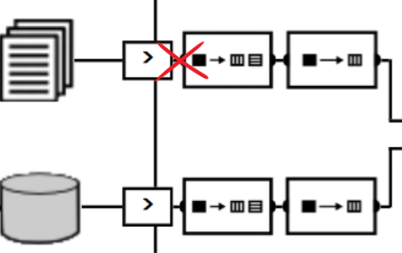
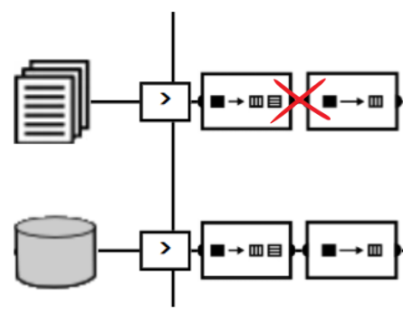
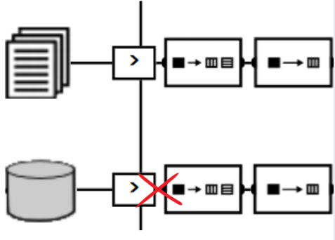
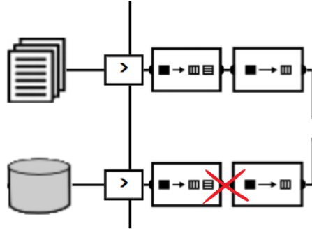
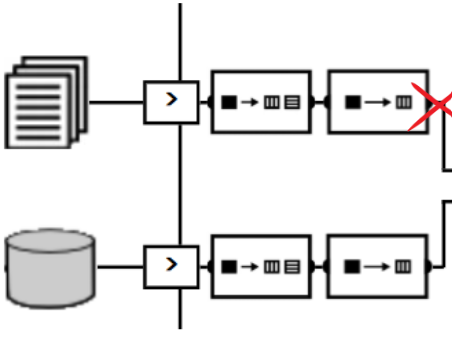
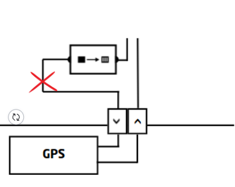
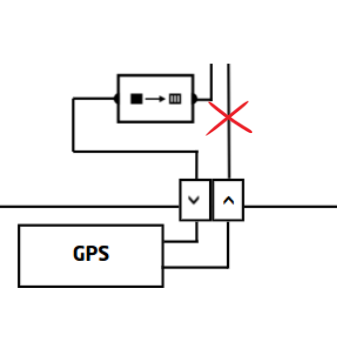
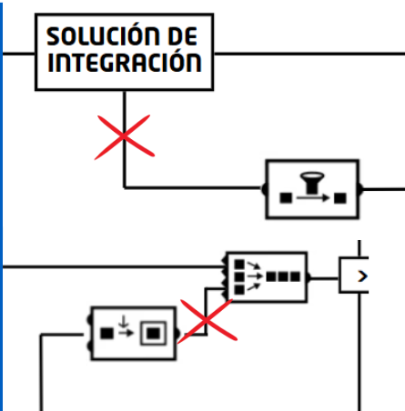

# CENTRAL ELÉCTRICA

**Autores:**
- David Hinojosa García
- Ilyasse Abida El Jihaoui
- Rubén Vicente Baldallo

---

## Índice

- Introducción al problema
- Planteamiento DSL
- XPath ($\chi\rho\alpha\tau\eta$)
- Solución de Integración
- Ejemplos de mensajes

---

## Introducción al Problema

- **Contexto:** La distribuidora ACME necesita predecir el consumo eléctrico de sus clientes.
- **Requisitos del nuevo modelo:**
  - Recepción de datos por **RPC**.
  - Datos limitados a los **últimos 15 minutos**.
  - Inclusión obligatoria de **coordenadas GPS**.
- **Reto de integración:** 
  - Unificar información dispersa de múltiples fuentes.
  - Filtrar los intervalos de tiempo.
  - Usar un servicio externo para convertir direcciones postales en coordenadas GPS antes de entregar los datos al modelo.

---

## XPath ($\chi\rho\alpha\tau\eta$)

Estructura de datos XML base para las consultas:

```xml
<?xml version="1.0" encoding="UTF-8"?>
<results timestamp="Wed, 07 Oct 26 19:56:45">
  <user>
    <id>123jhkh</id>
    <name>Manolete</name>
  </user>
  <direccion>
    <calle>manolete barroco</calle>
    <numero>89</numero>
  </direccion>
  <fecha>Wed, 05 Oct 26 19:56:45</fecha>
  <consumo>30</consumo>
</results>
```

---

## XPath ($\chi\rho\alpha\tau\eta$) - Consultas

- Selección de nodos clave en el documento XML:
  - `//user | //direccion | //fecha | //consumo`
- Permite filtrar y extraer de forma declarativa los elementos necesarios para la normalización del flujo de telemetría.
---


------

#### Ejemplos de Mensajes: Fichero



-
  ```xml
    <?xml version="1.0" encoding="UTF-8" ?>
      <results timestamp="Wed, 07 Oct 26 19:56:45">
          <factura>
            <user>
              <id>123jhkh</id>
              <name>Manolete</name>
            </user>
            <direccion>
              <calle>manolete barroco</calle>
              <numero>89</numero>
            </direccion>
            <fecha>Wed, 05 Oct 26 19:56:45</fecha>
            <consumo>30</consumo>
          </factura>
        <factura>
          <user>
            <id>123phkh</id>
            <name>Juanita</name>
          </user>
          <direccion>
            <calle>juanita barroco</calle>
            <numero>90</numero>
          </direccion>
          <fecha>Wed, 05 Oct 26 19:50:45</fecha>
          <consumo>35</consumo>
        </factura>
      </results>
  ```
---

### Ejemplos de Mensajes: Spliter-Fichero



-
  ```xml
  <?xml version="1.0" encoding="UTF-8" ?>
    <results timestamp="Wed, 07 Oct 26 19:56:45">
        <factura>
          <user>
            <id>123jhkh</id>
            <name>Manolete</name>
          </user>
          <direccion>
            <calle>manolete barroco</calle>
            <numero>89</numero>
          </direccion>
          <fecha>Wed, 05 Oct 26 19:56:45</fecha>
          <consumo>30</consumo>
        </factura>
    </results>
  ```
---

### Ejemplos de Mensajes: BD



- 
  ```xml
  <?xml version="1.0" encoding="UTF-8" ?>
    <results timestamp="Wed, 07 Oct 26 19:56:45" >
      <result>
        <userID>123jhkh</userID>
        <direccion>
          <calle>manolete barroco</calle>
          <numero>89</numero>
          <piso>False</piso>
          <industrial>True</industrial>
        </direccion>
        <fecha>Wed, 05 Oct 26 19:56:45</fecha>
        <consumo>30</consumo>
      </result>
      <result>
        <userID>456lkjh</userID>
        <direccion>
          <calle>la paz</calle>
          <numero>24</numero>
          <piso>True</piso>
          <industrial>False</industrial>
        </direccion>
        <fecha>Mon, 05 Oct 19 08:53:42</fecha>
        <consumo>28</consumo>
      <result>
    </results>
  ```
---

### Ejemplos de Mensajes: BD-Spliter



- 
  ```xml
    <?xml version="1.0" encoding="UTF-8" ?>
    <results timestamp="Wed, 07 Oct 26 19:56:45" >
      <result>
        <userID>123jhkh</userID>
        <direccion>
          <calle>manolete barroco</calle>
          <numero>89</numero>
          <piso>False</piso>
          <industrial>True</industrial>
        </direccion>
        <fecha>Wed, 05 Oct 26 19:56:45</fecha>
        <consumo>30</consumo>
      </result>
      <result>
        <userID>456lkjh</userID>
        <direccion>
          <calle>la paz</calle>
          <numero>24</numero>
          <piso>True</piso>
          <industrial>False</industrial>
        </direccion>
        <fecha>Mon, 05 Oct 19 08:53:42</fecha>
        <consumo>28</consumo>
      <result>
    </results>
  ```
---

### Ejemplos de Mensajes: Traductor



-
  ```xml
  
  <?xml version="1.0" encoding="UTF-8" ?>
  <results timestamp="Wed, 07 Oct 26 19:56:45">
      <direccion>
        <calle>manolete barroco</calle>
        <numero>89</numero>
      </direccion>
      <fecha>Wed, 05 Oct 26 19:56:45</fecha>
      <consumo>30</consumo>
  </results>

---

### Ejemplos de Mensajes: Entrada GPS



-
  ```xml
  <?xml version="1.0" encoding="UTF-8"?><xsl:stylesheet version="1.0"xmlns:xsl="http://www.w3.org/1999/XSL/Transform"><xsl:output method="xml" encoding="UTF-8" indent="yes"/> 
  <xsl:template match="/results">
    <results timestamp="{@timestamp}" id="{@id}">
      <gps>      
        <latitud>123</latitud>
        <longitud>34.7</longitud>
        <altitud>36.5</altitud>
      </gps>
    </results>
  </xsl:template>
  </xsl:stylesheet>

---

### Ejemplos de Mensajes: Salida GPS



-
  ```xml
  <?xml version="1.0" encoding="UTF-8" ?>
  <results timestamp="Wed, 07 Oct 26 19:56:45" id=12223kj12>
    <gps>
      <latitud>123</latitud>
      <longitud>34.7</longitud>
      <altitud>36.5</altitud>
    </gps>
  </results>

---

## Ejemplos de Mensajes: Enriquecimiento GPS


-
  ```xml
  <?xml version="1.0" encoding="UTF-8"?>
  <results timestamp="Wed, 07 Oct 26 19:56:45" id="12223kj12">
    <direccion>
      <calle>manolete barroco</calle>
      <numero>89</numero>
    </direccion>
    <fecha>Wed, 05 Oct 26 19:56:45</fecha>
    <consumo>30</consumo>
    <gps>
      <latitud>123</latitud>
      <longitud>34.7</longitud>
      <altitud>36.5</altitud>
    </gps>
  </results>
  ```


---

# **¡GRACIAS!**

